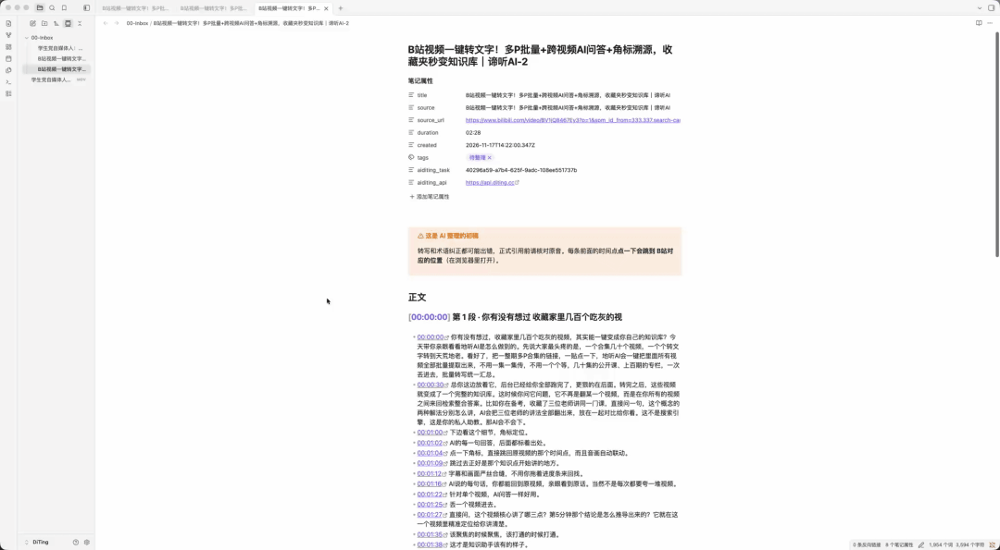

# AiDiTing — Obsidian plugin



*Click a timestamp in a generated note → the Bilibili video jumps to that second. 点一下笔记里的时间点，就跳回原片那一秒。*

> Turn audio and video files in your vault — or a Bilibili / Douyin / Xiaohongshu link — into timestamped, chaptered Markdown notes.
> Only creates new notes; never modifies existing ones.
> Desktop only. Requires an API key from <https://aiditing.cn/workspace?from=obsidian&c=github-readme> (free tier: 30 minutes / month).

---

## 中文说明（速览）

把 Vault 里的音视频，或 **B站 / 抖音 / 小红书的链接**，转成带时间戳、自动分章节的 Markdown 笔记。

> 完整中文文档（配置项、命令、隐私说明）见下方「安装」之后的内容。

- **逐句时间点**：本地文件点一下就跳到原声（同页播放器跟着走），B站视频跳到网页对应位置
- **B站多P 合集整季提交**：一次勾选多集，每集生成一篇笔记，标题不会串
- **只新建，不改动**：不会碰你已有的任何笔记；重名自动加序号
- **原文可溯源**：frontmatter 里记着任务号与源链接，删除笔记也不影响已生成的内容

免费额度 30 分钟/月，API Key 在 <https://aiditing.cn/workspace?from=obsidian&c=github-readme> 创建（扫码登录，不用注册表单）。

仅支持**桌面版** Obsidian（插件需要访问本地文件系统）。

Chinese documentation is further down: [中文说明](#中文说明).

## What it does

- Pick an audio or video file in your vault (file menu, or command palette), or run **Transcribe from link** and paste a video URL. The plugin writes **new notes** into your target folder (default `00-Inbox`).
- A multi-part Bilibili video becomes one note per part; you tick which parts you want. You can paste the whole share text copied from the mobile app — the plugin extracts the URL.
- The note contains frontmatter (source file or source URL, duration, task ID), a summary, chapter headings, the transcript with timestamps, and a plain-text body without timestamps.
- It **only creates new notes**. It never edits, moves, or deletes existing notes. Name collisions get a numeric suffix, for example `x.md` becomes `x-2.md`.
- Processing time depends on file length, network conditions, and the current queue. There is no fixed time promise — the interface only reports the current status.

## What it does not do

- **No links outside the three platforms.** Bilibili, Douyin and Xiaohongshu only. Anything else (YouTube, course platforms, podcast pages) has to be downloaded and uploaded as a local file.
- **No paywall bypass.** Only publicly accessible content is processed. Members-only, paid, or private videos will fail.
- **No in-place updates.** There is no "update the existing note" action.
- **No mobile support.** `isDesktopOnly: true`.
- **No path confirmation for links.** A single link may write a dozen notes, so the plugin does not ask per file; it writes into `00-Inbox` and never overwrites.

## Privacy

This plugin uploads the file you select (or the platform link you paste) to `api.diting.cc` for transcription.

- What leaves your machine: the file itself, its name, its duration — or just the URL for link transcription.
- Where it goes: `api.diting.cc`, our own server. No third-party storage.
- What it is used for: producing the transcript and the note for that one task.
- Not used for model training, not resold, not shared with third parties.
- **Without an API key nothing is uploaded at all** — the plugin only reads files locally.
- Your API key stays on your machine (plugin settings). It is sent only in the `Authorization` header to our own API — never in a URL, never logged, never shared with third parties. Our server stores only a hash and a short prefix of it.
- **No analytics.** The plugin sends no telemetry. Our server only sees that a task was submitted from the plugin (the `client` field on the task row) for quota accounting and troubleshooting; it never records which notes you open.
- It never reads the content of your other notes. To list transcribable files it enumerates vault paths (`vault.getFiles`) and filters by extension only.

## Install

1. Settings → Community plugins → Browse → search **AiDiTing** → Install, then Enable.
2. Open the plugin settings and click **Create key** to open the workspace, sign in, create an API key, and copy it.
3. Back in Obsidian, run the command **Paste API key from clipboard**.

Manual install: copy `main.js`, `manifest.json` and `styles.css` into `<Vault>/.obsidian/plugins/aiditing/`.

License: MIT (see [LICENSE](./LICENSE)). The `main.js` in this repository is a build artifact, **unminified and unobfuscated** so it can be read directly. Source lives in `src/`, tests in `tests/`, and the build is reproducible with `npm install && npm run build`.

---

## 中文说明

把 Vault 里的音视频文件，或一个 B站 / 抖音 / 小红书链接，整理成带时间戳与章节的 Markdown，落进你指定的目录。**只新增文件，不改动、不移动已有笔记。**

对应页面：<https://aiditing.cn/connect/obsidian?from=obsidian&c=github-readme>

### 第一次用：两步

1. 装好后 Obsidian 会弹一条提示，**点它**打开工作台（每月 30 分钟免费），登录后创建 API Key 并复制
2. 回 Obsidian 运行命令 **`粘贴 API Key（从剪贴板）`**，Key 自动填好，不用再去翻设置页

没有 Key 时插件不会上传任何文件。

### 现在能做什么

- 选中（或右键）一个 Vault 内的音频/视频文件 → 生成笔记，写入目标目录（默认 `00-Inbox`）
- **贴链接也能整理**：命令面板运行 `从链接整理（B站 / 抖音 / 小红书）`，可直接粘贴 App 里复制出来的整段分享文案；多P 合集可勾选要哪几集，一集一篇
- 本地上传在写入前显示最终路径，路径可改，确认后才落盘
- 重名自动加序号（`x.md` → `x-2.md`），绝不覆盖
- 笔记结构：YAML 前置元数据（来源、时长、任务号）→ 原媒体嵌入 → 摘要 → 按时间切的章节 → 逐句带时间戳的正文 → 去时间戳的纯文本
- 原媒体嵌入（可关）：把 Vault 里的原音视频嵌到笔记顶部；**点正文里的 `00:12` 直接跳到该秒并播放**（阅读模式下）

### 不做什么（写在这里，免得你试完失望）

- **链接只支持三家**：B站 / 抖音 / 小红书。别的站点（YouTube、网课平台、播客页等）请下载后走本地上传
- **不绕过登录与付费墙**：只处理公开可访问的内容，充电专属、会员专享、私密视频会失败
- **链接转写不弹路径确认**：可能一次写十几篇，逐篇弹窗会烦人；默认写入 `00-Inbox`，重名自动加序号，不会覆盖
- **不写移动端**：`isDesktopOnly: true`，手机端 Obsidian 装不上，也没验证过
- **不改已有笔记**：没有「更新原笔记」这个操作
- **不承诺耗时**：界面只报当前状态（排队中 / 进度百分比），不显示预计完成时间——真实耗时取决于文件时长、网络与队列
- **时间点跳转只在阅读模式生效**：Live Preview 下时间点是编辑器文本，不是 DOM 元素，挂不上点击事件——这是技术限制，不是没做。切到阅读模式才能点
- **没有嵌入原媒体就跳不了**：笔记里没有 `![[原音视频]]` 时，点时间点会明确提示「找不到原媒体播放器」，不会静默无反应

### 隐私与数据（上架审核会看这一节）

**这个插件会把你选中的文件（或粘贴的平台链接）上传到我们的服务器。** 用之前请先确认这一点可以接受：

| 问题 | 回答 |
|---|---|
| 什么数据会离开你的电脑 | 你主动选择的那一个音视频文件本身、它的文件名、时长；链接转写则只有那条链接 |
| 发到哪里 | `api.diting.cc`（爱谛听自己的服务器）。不经过任何第三方网盘 |
| 用来做什么 | 只用于生成这次的转写文本与笔记 |
| 会不会用来训练模型 | **不会** |
| 会不会转发给别人 | **不会**，不做二次分发 |
| 没配 Key 会不会上传 | **不会**。没有 Key 时插件一个字节都不发，只在本地读文件 |
| API Key 存在哪、怎么发 | 只存在你本机的插件配置里。请求时放进 `Authorization` 头发给我们自己的 API，**不写进 URL、不写进日志、不发第三方**；服务端只存哈希与前后缀，库里没有明文 |
| 会不会统计我的使用行为 | **不做任何行为埋点**。插件不向任何第三方发送统计。我们服务器只知道「有一个任务是通过插件提交的」（任务表的 `client` 字段），用于算额度与排查问题，不记录你打开了哪些笔记 |
| 会不会翻看我的其他笔记 | **不读内容**。为了在选文件时列出可转写的音视频，插件会枚举 vault 内的文件路径（Obsidian 的 `vault.getFiles`），但只按扩展名挑出音视频，不打开、不解析、不上传任何你没选中的文件 |
| 想删掉已经上传的数据 | 联系客服提出，我们处理 |

只想留在本机的操作（读文件、写 Markdown）全部在本地完成，不上传。

### 安装

#### 从社区插件市场（推荐）

设置 → 第三方插件 → 浏览 → 搜索 **AiDiTing** → 安装并启用。

目录里的名字是英文 `AiDiTing`，不是中文「爱谛听」（Obsidian 的 manifest 命名规范只接受 Basic Latin 字符），所以搜中文搜不到。目录清单每小时同步一次，刚上架时可能还搜不到，重启 Obsidian 或稍后再试。

#### 手动安装（备选）

```bash
# 1. 把三个文件放进 Vault 的插件目录
<Vault>/.obsidian/plugins/aiditing/
├─ main.js
├─ manifest.json
└─ styles.css
```

2. Obsidian → 设置 → 第三方插件 → 关闭「安全模式」
3. 在「已安装插件」里找到「AiDiTing」，启用
4. 打开插件设置 → 点「去创建」打开工作台，登录后创建 API Key，复制回来粘贴（免费额度每月 30 分钟）

### 配置项

| 设置 | 默认 | 说明 |
|---|---|---|
| API Key | 空 | 在[工作台](https://aiditing.cn/workspace?from=obsidian&c=github-readme)登录后创建；为空时不允许执行任务，也不会上传任何文件 |
| API 地址 | `https://api.diting.cc` | 除非另行通知，不要改 |
| 笔记落库目录 | `00-Inbox` | 不存在会自动创建 |
| 章节切分间隔 | 10 分钟 | 填 0 则整篇一节 |
| 写入前确认路径 | 开 | 仅本地上传生效；链接转写不弹窗 |
| 生成后打开笔记 | 开 | |

### 命令

- `整理当前音视频文件` —— 当前编辑区是音视频时可用
- `从 Vault 里选一个音视频整理` —— 弹选择框
- `从链接整理（B站 / 抖音 / 小红书）` —— 粘贴链接或整段分享文案
- 文件列表右键 → `爱谛听：整理成笔记`

## FAQ / 常见问题

**能转 B站多P 合集吗？ / Multi-part Bilibili videos?**
能。一次勾选多集，每集生成一篇独立笔记，标题不会串。
Yes — one note per part, and you tick which parts you want.

**会议录音、网课视频能转成文字吗？ / Meeting recordings and online course videos?**
能。Vault 里的任何本地音视频都可以（mp3 / mp4 / m4a / wav 等），不限于链接。
Yes — any local audio or video file in your vault.

**支持 YouTube、网课平台、播客页的链接吗？ / YouTube, course platforms, podcast pages?**
不支持链接直转，请下载后走本地上传。
No link support for those platforms. Download the file and upload it locally instead.

**会覆盖或改动我已有的笔记吗？ / Will it overwrite existing notes?**
不会。只新建文件，重名自动加序号（`x.md` → `x-2.md`）。
Never. It only creates new notes.

**免费吗？ / Is it free?**
每月 30 分钟免费额度，足够跑完整流程再决定。
Free tier: 30 minutes per month.

**文件传到哪儿？ / Where is my file uploaded?**
传到我们自己的服务器（`api.diting.cc`），只用于生成这一次的转写结果，不用于模型训练、不转售、不分享给第三方。
To our own server, only to produce that one transcript.

**手机端能用吗？ / Mobile support?**
不能。仅桌面版 Obsidian（`isDesktopOnly: true`）。
Desktop only.

**点时间戳没反应？ / Timestamp jumping does not work?**
只在**阅读模式**（Reading view）生效。Live Preview 下时间点是编辑器里的纯文本，不是 DOM 元素，挂不上点击事件；另外笔记里需要有嵌入的原音视频。
Reading view only. In Live Preview the timestamp is plain editor text, not a DOM element.

**有行为埋点吗？ / Any analytics?**
没有。插件不向任何第三方发送统计，服务端只知道「有一个任务来自插件」，用于算额度与排查问题。
No analytics or telemetry.

## 相关产品 / Related

- 不装 Obsidian，只想把视频转成文字：<https://diting.cc/?from=obsidian&c=github-readme>
- 想把视频沉淀成可检索的知识库：<https://ditingyun.cn/?from=obsidian&c=github-readme>

